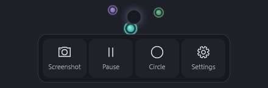
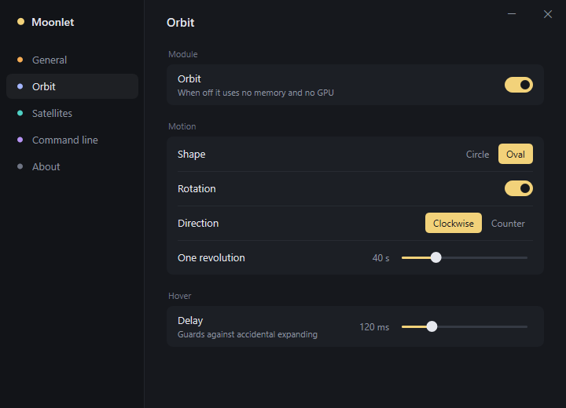

# Moonlet

A small, quiet layer of interface on top of Windows 10/11.

[English](#english) · [Русский](#русский)


## English

Moonlet puts an "orbit" at the top center of the screen: a small dark core
with satellites slowly circling around it, one satellite per feature. It is
written in Rust directly on Win32, Direct2D and DirectComposition — no web
views, no GUI frameworks.

- **Light.** One ~680 KB `moonlet.exe`, about 9 MB of RAM.
- **Quiet.** No polling: the process sleeps until Windows reports an event.
  Animations run inside DWM, so Moonlet itself uses 0% CPU while things move.
- **Kind to the battery.** Animations stop on battery power (can be turned
  off) and while a full-screen game or video is running. The integrated GPU
  is used, so a laptop's discrete GPU stays asleep.
- **Private.** No telemetry. The only network request is the daily update
  check, and it can be turned off.
- **Hands off the system.** No injection into `explorer.exe`, no patched
  system files. The taskbar, Start menu and Explorer are left alone.

### What it does

- **Satellites.** Clock (the ring fills over the hour), Music (the track's
  progress; works with Spotify, browsers and players that show up in the
  Windows media controls) and Battery (charge and state). Their color and
  ring show the state without opening anything.
- **Hover the core** and the satellites line up in fixed places with labels.
  Hover a satellite to see its card: date and time, battery details, or the
  current track with cover art, playback buttons and system volume. The mouse
  wheel over the music satellite changes the volume.
- **Click the core** to open the hub: Moonlet actions (area screenshot, command
  line, music, pause the orbit, circle or oval, settings) and your own tiles —
  apps, files, folders, websites and command line texts like `volume 30`.
  Pick them and their order in Settings → Quick access.
- **Temporary satellites.** Plugging the charger in or out and a low battery
  (20% and 10%) send a small copy of the battery satellite out with a short
  note. A new song can do the same (off by default).
- **Command line.** `Ctrl+Alt+Space` slides a field out of the core:
  - apps from the Start menu (it understands a wrong keyboard layout and
    Russian typed for English names: `ntktuhfv` finds Telegram);
  - Moonlet commands: `pause`, `next`, `back`, `volume 30`, `circle`, `oval`,
    `rotate`, `screenshot`, `settings` (Russian words work too);
  - a calculator: `(1,5+2)*3`, `2^10`, `15%`, `√16`; Enter copies the answer;
  - `github.com` opens the site, anything else searches the web with your
    default browser's search engine.

  Esc or a click elsewhere closes it. The line is not shown during full-screen
  apps, and it takes no memory while closed.




### Install

1. Download `moonlet.exe` from [Releases](https://github.com/BeautifulPanda/moonlet/releases)
   and put it in any folder you can write to (for example `%LOCALAPPDATA%\Moonlet`).
2. Run it. The moon icon appears in the tray; the menu has everything,
   including "Start with Windows".

The file is not code-signed, so Windows SmartScreen may warn about an unknown
publisher the first time.

### Settings

Tray menu → "Open settings" (or the hub tile, or `settings` in the command
line) opens the settings window: language, start with Windows, updates, orbit
shape and speed, quick access (which satellites sit on the orbit and which
tiles are in the hub, in what order; apps are found by searching the Start
menu), temporary satellites, the command line hotkey and web search. Every
change applies at once. The window is a separate process, so closing it frees all of its memory.
"What's new" in General → Updates lists the changes of the installed version.



Everything is stored in `%APPDATA%\Moonlet\config.toml` ("Open config.toml"
in the tray menu). The file is commented and can be edited by hand, including
sizes that the window does not show; changes apply as soon as it is saved.

A `config.toml` created by an older version keeps working; missing sections
take their defaults, for example

```toml
[launcher]
hotkey = "Ctrl+Alt+Space"
search = ""   # empty: the browser's engine, or e.g. "https://duckduckgo.com/?q="

[hub]
# Moonlet actions: screenshot, launcher, play, next, previous, rotation, shape, settings.
# Own tiles: "app:path", "file:path", "folder:path", "url:address", "cmd:text"; a name after |.
tiles = ["screenshot", "launcher", "url:https://github.com|GitHub", "settings"]
```

### Updates

Moonlet checks GitHub a minute after start and then once a day. Modes, in the
tray menu or in `config.toml`:

- `auto` (default) — download, verify and install the new version, then restart.
  It waits while a full-screen app is running.
- `check` — only show a notification; clicking it installs the update.
- `off` — never connect to the network.

Every release is signed. Moonlet verifies the signature with a key built into
the program and refuses any file that does not match.

### Building

Requirements: Windows 10 x64, [Rust](https://rustup.rs) (MSVC toolchain),
Visual Studio Build Tools with the C++ workload.

```
cargo build --release
```

The result is `target\release\moonlet.exe`. Features can be left out at build
time, for example `--no-default-features --features orbit` builds the orbit
without music and updates.

### Plans

- Bluetooth toggle; files, folders and system commands in the command line.
- Notes and reminders.
- Scenarios: open a set of apps and put the windows in place with one word.
- Games: FPS counter (optional, off by default).

### License

[MIT](LICENSE)

## Русский

Moonlet добавляет поверх Windows небольшой тихий слой интерфейса — «орбиту»
у верхнего края экрана: тёмное ядро и медленно кружащие вокруг него спутники,
по одному на функцию. Написан на Rust прямо на Win32, Direct2D и
DirectComposition — без веб-движков и GUI-фреймворков.

- **Лёгкий.** Один `moonlet.exe` около 680 КБ, около 9 МБ памяти.
- **Тихий.** Никакого опроса: процесс спит, пока Windows не сообщит о событии.
  Анимации выполняет DWM, сам Moonlet в это время не тратит CPU.
- **Бережёт батарею.** Анимации останавливаются от батареи (можно отключить)
  и во время полноэкранных игр и видео. Работает на встроенной видеокарте —
  дискретная в ноутбуке не просыпается.
- **Приватный.** Никакой телеметрии. Единственный выход в сеть — проверка
  обновлений раз в сутки, её можно выключить.
- **Не лезет в систему.** Не внедряется в `explorer.exe` и не патчит системные
  файлы. Панель задач, «Пуск» и Проводник не трогает.

### Что умеет

- **Спутники.** Часы (кольцо заполняется за час), Музыка (прогресс трека;
  работает со Spotify, браузерами и плеерами, которые видны в медиа-панели
  Windows) и Батарея (заряд и состояние). Цвет и кольцо показывают состояние,
  ничего не раскрывая.
- **Наведение на ядро** — спутники встают на постоянные места с подписями.
  Наведение на спутник открывает карточку: дата и время, подробности о батарее
  или текущий трек с обложкой, кнопками и громкостью. Колёсико над спутником
  музыки меняет громкость.
- **Клик по ядру** — хаб: действия Moonlet (скриншот области, командная
  строка, музыка, пауза орбиты, круг или овал, настройки) и свои плитки —
  программы, файлы, папки, сайты и команды строки вроде `громкость 30`.
  Что и в каком порядке — в настройках, раздел «Быстрый доступ».
- **Временные спутники.** Подключили или отключили зарядку, заряд упал до 20%
  и 10% — из спутника батареи вылетает его маленькая копия с короткой надписью.
  Так же можно показывать новый трек (по умолчанию выключено).
- **Командная строка.** `Ctrl+Alt+Space` — из ядра выезжает поле:
  - программы из меню «Пуск» (понимает неверную раскладку и русское название
    английской программы: `ntktuhfv` находит Telegram);
  - команды Moonlet: `пауза`, `дальше`, `назад`, `громкость 30`, `круг`,
    `овал`, `вращение`, `скриншот`, `настройки` (английские слова тоже);
  - калькулятор: `(1,5+2)*3`, `2^10`, `15%`, `√16`; Enter копирует ответ;
  - `github.com` открывает сайт, остальное ищется в интернете поисковиком
    браузера по умолчанию.

  Esc или клик мимо закрывают строку. Во время полноэкранных приложений она
  не открывается, а закрытая не занимает памяти.

### Установка

1. Скачайте `moonlet.exe` в [Releases](https://github.com/BeautifulPanda/moonlet/releases)
   и положите в любую папку, куда у вас есть права на запись
   (например, `%LOCALAPPDATA%\Moonlet`).
2. Запустите. В трее появится значок-полумесяц; в его меню есть всё,
   включая «Запускать с Windows».

Файл не подписан сертификатом, поэтому при первом запуске SmartScreen может
предупредить о неизвестном издателе.

### Настройки

Меню трея → «Открыть настройки» (или плитка хаба, или `настройки` в командной
строке) открывает окно настроек: язык, автозапуск, обновления, форма и скорость
орбиты, быстрый доступ (какие спутники на орбите и какие плитки в хабе, в каком
порядке; программу можно найти поиском по «Пуску»), временные спутники,
клавиша и поиск командной строки. Каждая правка применяется сразу. Окно — отдельный процесс:
закрыли его, и вся его память освободилась. «Что нового» в «Общих» → «Обновления»
показывает изменения установленной версии.

Всё хранится в `%APPDATA%\Moonlet\config.toml` («Открыть config.toml» в меню
трея). Файл с пояснениями, его можно править руками, в том числе размеры,
которых нет в окне; изменения применяются сразу после сохранения.

`config.toml` от прежней версии работает как есть: для разделов, которых
в нём нет, действуют значения по умолчанию, например

```toml
[launcher]
hotkey = "Ctrl+Alt+Space"
search = ""   # пусто — поисковик браузера, или, например, "https://duckduckgo.com/?q="

[hub]
# Действия Moonlet: screenshot, launcher, play, next, previous, rotation, shape, settings.
# Свои плитки: "app:путь", "file:путь", "folder:путь", "url:адрес", "cmd:текст"; имя — после |.
tiles = ["screenshot", "launcher", "url:https://github.com|GitHub", "settings"]
```

### Обновления

Moonlet проверяет GitHub через минуту после запуска и дальше раз в сутки.
Режимы — в меню трея или в `config.toml`:

- `auto` (по умолчанию) — скачать, проверить и поставить новую версию, затем
  перезапуститься. Во время полноэкранных приложений ждёт.
- `check` — только сообщить; клик по уведомлению ставит обновление.
- `off` — вообще не выходить в сеть.

Каждый выпуск подписан. Moonlet проверяет подпись встроенным в программу
ключом и не ставит файл, который ей не соответствует.

### Сборка

Нужны: Windows 10 x64, [Rust](https://rustup.rs) (MSVC), Visual Studio Build
Tools с набором C++.

```
cargo build --release
```

Готовый файл — `target\release\moonlet.exe`. Части можно исключить при сборке,
например `--no-default-features --features orbit` соберёт орбиту без музыки и
обновлений.

### Планы

- Переключатель Bluetooth; файлы, папки и системные команды в командной строке.
- Заметки и напоминания.
- Сценарии: одним словом открыть нужные программы и расставить окна.
- Игры: счётчик FPS (по желанию, по умолчанию выключен).

### Лицензия

[MIT](LICENSE)
